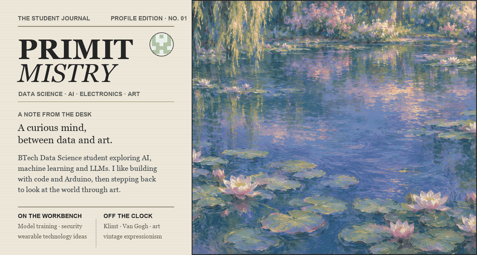

# Primit Mistry

**BTech Data Science student · AI, machine learning, LLMs · Arduino · Art**

  

<a href="https://primit-progenis.github.io/Primit-progenis/"><b>Open the interactive pond homepage</b></a>

---

## About Me

I'm a second-year **BTech Data Science** student in semester 3 who enjoys turning data into useful ideas. I started coding at 16 with WhiteHat Jr, and I've been building ever since. Outside of data science, I like experimenting with Arduino and exploring art, especially vintage expressionism.

- Currently exploring **AI, machine learning, and LLMs**
- Studying **data science** and model training
- Experimenting with **Arduino and electronics**
- Exploring ideas in **biotech and quantum technology**
- Contact: **[mprimit123@gmail.com](mailto:mprimit123@gmail.com)**

## Skills

<b>Data Science and AI</b>

 

Data science (intermediate), machine learning, model training, and large language models.

<b>Electronics</b>

 

Arduino-based engineering (intermediate), sensors, microcontrollers, and wearable prototypes.

<b>Programming</b>

 

Data structures and algorithms, object-oriented programming, and web development.

---

## Public Repositories by Category

<b>AI and Machine Learning</b>

 

- **Teachable Machine Image Demo** — browser-based webcam image classification with TensorFlow.js.  
  [View repository](https://github.com/Primit-progenis/teachable-model)

<b>Voice Assistants</b>

 

- **Luna AI** — Python voice assistant with speech input, spoken responses, Wikipedia summaries, time, and browser shortcuts.  
  [View repository](https://github.com/Primit-progenis/Luna-AI)

<b>Cybersecurity and Smart Home</b>

 

- **Fenceline** — collaborative ACE hackathon project at NMIMS, demonstrating simulated smart-home threat scoring, guest access, and containment previews.  
  [View repository](https://github.com/Primit-progenis/Fenceline-Cybersec)

<b>Web Apps and Communications</b>

 

- **Video Chat Room** — room-based WebRTC audio/video and peer-to-peer chat with a WebSocket signaling server.  
  [View repository](https://github.com/Primit-progenis/video-chat)

<b>Games and Game Libraries</b>

 

- **Snake Game** — Python and Pygame grid-based game.  
  [View repository](https://github.com/Primit-progenis/Snake-Game)
- **Pygame** — public fork of the upstream Pygame project.  
  [View fork](https://github.com/Primit-progenis/pygame)

<b>Programming Starters</b>

 

- **hello-world** — starter repository for programming experiments.  
  [View repository](https://github.com/Primit-progenis/hello-world)
- **java** — Java learning repository, currently without source files.  
  [View repository](https://github.com/Primit-progenis/java)

<b>Profile and Portfolio</b>

 

- **Primit-progenis** — this profile README and the interactive water-lily page.  
  [View profile repository](https://github.com/Primit-progenis/Primit-progenis) · [Open the interactive page](https://primit-progenis.github.io/Primit-progenis/)

## Other Explorations

<b>EchoBand and Quantum Tech</b>

 

Alongside my public repositories, I have explored a biotech wearable concept called EchoBand and early ideas in quantum technology.

---

## Art I Love

<b>Artists I keep coming back to</b>

 

- **Gustav Klimt** — pattern, color, and emotion
- **Vincent van Gogh** — movement and expressive brushwork
- **Caravaggio** — dramatic light and shadow
- **Banksy** — art with a sharp point of view

I'm drawn mostly to vintage expressionism. The water-lily artwork above is an original digital homage to Monet's pond paintings.

---

## GitHub Stats

 

---

*Thanks for stopping by. Feel free to reach out or collaborate.*

